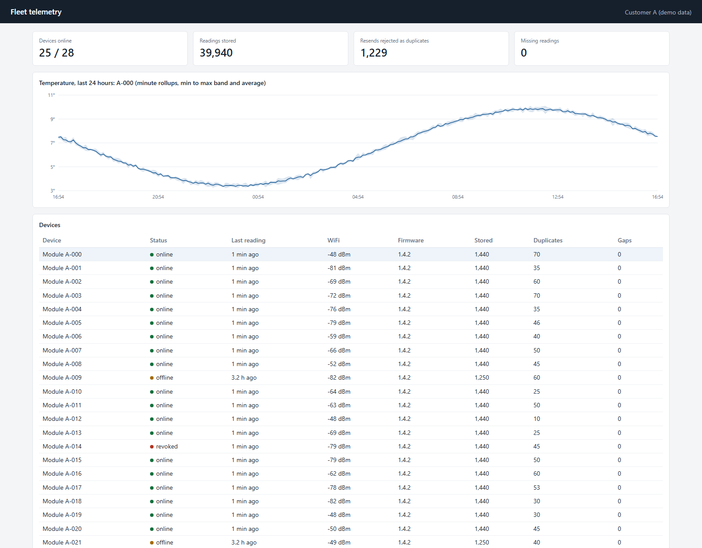

# Fleet Telemetry: ESP32 to Database to Dashboard

End-to-end data path for modules that sit on customers' WiFi: firmware, signed uploads, a server that survives bad networks, per-customer access and a live dashboard. Built to the requirements most IoT projects hit in the field.

## How it behaves

- **Devices only connect outbound over HTTPS**, so they work behind customer NAT and firewalls.
- **Each module has its own key.** Every upload is signed with HMAC-SHA256 over the device id, time and body. One stolen module can be revoked without touching the rest. Tampered bodies, wrong keys and captured requests replayed later are refused.
- **No data lost, no duplicates.** The firmware keeps readings in a flash ring buffer and drops them only after the server's ack passes their sequence number. The server treats device id plus sequence as unique, so a resend never creates a row or skews a chart.
- **Customers only see their own devices.** Another customer's device returns 404, not 403.
- **Charts stay fast.** Dashboards read minute rollups, which only move for rows that were really new.

## Measured

One run of `python run_demo.py`: real HTTP against the real server on one laptop, 40 simulated devices, 24 simulated hours, with outages and lost answers injected.

| | |
|---|---|
| Readings generated | 57,220 |
| Readings stored | 57,220 |
| Missing readings | 0 |
| Answers lost on purpose | 363 |
| Resent readings rejected as duplicates | 1,795 |
| Device minutes offline | 7,792 |
| Throughput on SQLite | about 1,900 readings per second |

15 server tests cover signatures, replay, revocation, tenant isolation, resend handling and validation.

## Layout

- `server/`: FastAPI service and dashboard. SQLite keeps the demo self-contained, and the schema uses standard SQL that maps directly to MySQL or PostgreSQL.
- `simulator/`: devices with the same buffering and ack logic as the firmware.
- `firmware/`: PlatformIO project for ESP32 (Arduino framework): NVS credentials, LittleFS ring buffer, TLS with certificate checking, signed batches, watchdog.
- `tests/`: `pytest tests`

## Limits of this demo

The numbers come from simulated devices, not a deployed fleet. The firmware compiles for ESP32 and has not been run on hardware in this repo. It samples the chip's internal temperature as a placeholder sensor and uses factory provisioning over USB. BLE provisioning, OTA updates and flash encryption are the next steps for a production unit. The server stores device keys as plain text to keep the demo small, and production needs a secrets store.
